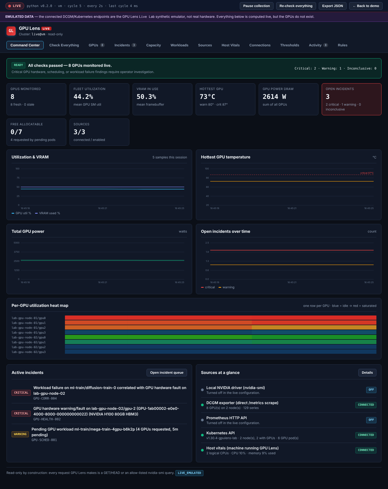
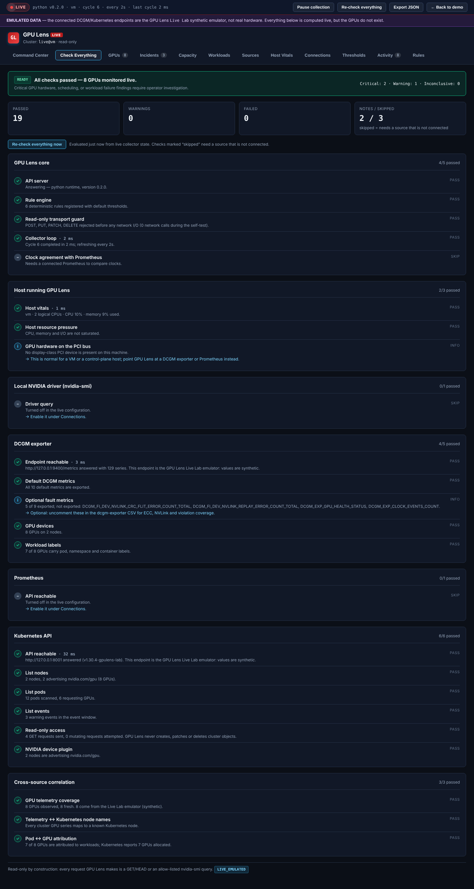

# GPU Lens — Open-Source GPU Fleet Reliability and Capacity Intelligence Platform

**GPU Lens** is a self-hosted, strictly read-only diagnostic and capacity intelligence layer for Kubernetes clusters operating NVIDIA data center GPUs. It correlates existing infrastructure signals—DCGM Exporter / Prometheus GPU telemetry, Kubernetes `Node` capacity/allocatable states, `Pod` container lifecycles, and scheduler/node `Events`—into deterministic, evidence-backed incident reports and transparent capacity efficiency audits.

---

## 0. Two parts, one console

- **Part 1 — Simulated demo.** The original console with six deterministic scenarios. Works fully offline and is unchanged.
- **Part 2 — Go Live.** Press the **Go Live** button and GPU Lens switches to real, read-only telemetry: it runs a preflight check of *every* source (local `nvidia-smi`, host vitals, DCGM exporter, Prometheus, Kubernetes API, cross-source correlation), then keeps collecting, merging and evaluating the same six rules live — with GPU cards, nodes & pods, incidents (with a resolved log), capacity, trend charts, host vitals, an activity log, live-editable thresholds, connection settings and JSON/CSV export. No GPU? `python3 scripts/live_lab.py` serves a clearly-labelled synthetic cluster to try it against.

Both parts use a clean **white** theme by default; the **Dark mode** button (bottom-left) switches to the original dark look and the choice is remembered in the browser.

Full guide: [`docs/LIVE.md`](docs/LIVE.md).




*Screenshots show Go Live connected to the synthetic Live Lab (hence the EMULATED DATA banner).*

---

## 1. Problem Statement

Operators of GPU clouds, AI training clusters, and inference platforms collect telemetry across disconnected layers:
1. **GPU Hardware Telemetry** (`dcgm-exporter` / Prometheus): SM compute utilization (`DCGM_FI_DEV_GPU_UTIL`), memory copy utilization (`DCGM_FI_DEV_MEM_COPY_UTIL`), framebuffer occupancy (`DCGM_FI_DEV_FB_USED`), temperature (`DCGM_FI_DEV_GPU_TEMP`), power (`DCGM_FI_DEV_POWER_USAGE`), XID hardware error codes (`DCGM_FI_DEV_XID_ERRORS`), HBM row-remap failures (`DCGM_FI_DEV_ROW_REMAP_FAILURE`), PCIe replay counters (`DCGM_FI_DEV_PCIE_REPLAY_COUNTER`), and optional ECC / NVLink / throttling counters.
2. **Kubernetes Control Plane State**: `Node` `capacity` vs. `allocatable` GPU counts, Node Problem Detector conditions (`GPUXIDErrors`, `GPUClockThrottling`), `Pod` phases, container exit codes/restarts, and `FailedScheduling` / `BackOff` events.

When a distributed training job crashes, stalls in `Pending`, or holds expensive H100/A100 accelerators at low compute utilization, engineers must manually correlate timestamps, GPU UUIDs, PCI bus addresses, node conditions, and pod bindings across Prometheus and `kubectl`. Worse, missing Prometheus scrapes or broken kubelet `pod-resources` socket bindings can create silent monitoring blind spots where dashboards appear "green" simply because telemetry stopped arriving.

**GPU Lens solves this investigation bottleneck without replacing existing tools, calling external AI APIs, or mutating cluster state.**

---

## 2. Live Application Screenshots (Captured from Running Offline Demo)

### Overview — Workload Failure Correlation & Fleet Health


### Incident Detail — Observed Facts, Supporting vs. Contradicting Evidence & Timeline


### Capacity & Utilization — Historical Series, VRAM Context & Non-Waste Methodology


### Stale & Uncorrelated Telemetry — Explicit Blind-Spot Detection


---

## 3. Core Capabilities & Six Deterministic Diagnostic Rules

See [`RULES.md`](RULES.md) for full rule specifications, thresholds, and suppression logic:

| Rule ID | Rule Name | Use Case Addressed | Key Safeguards & Epistemic Discipline |
| :--- | :--- | :--- | :--- |
| **`GPU-SCHED-001`** | Pending GPU Workload Scheduling Bottleneck | **A. GPU Scheduling Diagnosis** | Distinguishes aggregate capacity exhaustion, multi-node GPU fragmentation, device plugin de-allocation (`allocatable < capacity`), and `nodeSelector`/taint mismatches. Marks `inconclusive` instead of guessing if `FailedScheduling` events and node inventory are missing. |
| **`GPU-HEALTH-002`** | GPU Hardware Fault or Health Degradation | **B. GPU Health & Performance Warnings** | Evaluates XID errors, row-remap failures, PCIe replay counters, optional ECC DBE (`DCGM_FI_DEV_ECC_DBE_VOL_TOTAL`), NVLink CRC errors, and node allocatable drops. Never fabricates findings for unexported optional metrics. |
| **`GPU-UTIL-003`** | Persistently Low GPU Compute Utilization | **C. Persistently Low Utilization** | Flags running pods with mean `DCGM_FI_DEV_GPU_UTIL < 15%` over `>= 60m` (`>= 6` samples). **Never labels low utilization as proven waste**; cross-checks VRAM residency (`DCGM_FI_DEV_FB_USED`) to highlight memory-capacity-bound workloads (e.g., 70B LLM inference) and outputs a 4-step engineering checklist. |
| **`GPU-CORR-004`** | Workload Failure / Restart Correlation | **D. Workload Failure Correlation** | Correlates container terminations (`exitCode`, `reason`, `finishedAt`) with GPU faults in `[-15m, +5m]`. Explicitly separates hardware-corroborated crashes (e.g., XID 79) from userspace `OOMKilled` crashes where healthy GPU telemetry is recorded as **contradicting evidence**. |
| **`GPU-FRESH-005`** | Telemetry Source Unavailable, Stale, or Uncorrelated | **E. Monitoring Data Freshness** | Detects unreachable scrape targets, stale GPU timestamps (`> 180s`), and allocated GPUs missing `pod`/`namespace` labels (`pod-resources` socket blind spot). Missing data never defaults to `Healthy`. |
| **`GPU-THERM-006`** | GPU Thermal, Power Brake, or Memory Pressure | **B. GPU Envelope Warnings** | Detects GPU core temp `>= 80°C` / `>= 87°C`, HBM memory temp `>= 90°C`, active thermal/power throttling violations, and `>= 95%` framebuffer memory pressure. |

---

## 4. Non-Negotiable Safety & Architecture Constraints

- **Zero AI / LLM / External SaaS Dependencies**: No OpenAI, Anthropic, Gemini, MCP servers, vector databases, or external SaaS calls. In demo mode there are no network calls at all; in Go Live, GPU Lens contacts only the telemetry endpoints you point it at (or the conventional local addresses). All diagnostics are deterministic rules and statistical summaries.
- **Strictly Read-Only Infrastructure Access**: Enforced at the Go interface level, HTTP transport level (`ReadOnlyRoundTripper` in `internal/source/readonly_transport.go` blocks `POST`, `PUT`, `PATCH`, `DELETE`), and Kubernetes RBAC level (`deploy/kubernetes/rbac-readonly.yaml`).
- **No Remediation, Minimal Read-Only Host Access**: Never runs invasive `dcgmi diag` stress tests and never kills jobs, drains nodes, or modifies scheduling. The single local command Go Live may run is `nvidia-smi` with a fixed allow-list of query flags (no shell, no state-changing options, 8 s timeout); it can be turned off with `--no-nvidia-smi`.
- **100% Offline Reproducibility**: Ships with 6 deterministic cluster scenarios (`fixtures/scenario_1_healthy.json` through `fixtures/scenario_6_stale_telemetry.json`) generated by `scripts/generate_fixtures.py`.

---

## 5. Repository Structure

```text
gpu-lens/
├── cmd/gpulens/main.go                  # Go backend entrypoint (CLI flags, config validation, graceful shutdown)
├── internal/
│   ├── domain/models.go                 # Normalized domain models (ClusterSnapshot, GPUDevice, Incident, CapacityReport)
│   ├── config/                          # Typed configuration, DCGM metric mappings, validation & token redaction + tests
│   ├── rules/                           # Extensible 6-rule deterministic engine, fingerprinting & table-driven tests
│   ├── capacity/                        # GPU capacity & low-utilization GPU-hour calculator + tests
│   ├── source/                          # Sources (Fixture, K8s Read-Only, Prometheus, DCGM Exporter, nvidia-smi, host vitals) + tests
│   ├── live/                            # Go Live engine: collection, per-GPU merge, windowed rules, incident lifecycle, preflight + tests
│   ├── store/                           # Incident deduplication & persistence store + tests
│   └── api/                             # HTTP REST handlers, middleware & API integration tests
├── web/                                 # React + TypeScript + Vite operator console
│   ├── src/                             # Typed TSX components (App.tsx, api.ts, types.ts, jsx-runtime.ts, styles.css)
│   ├── src/live/                        # Part 2 console (LiveConsole, views, store, API client) — isolated from the demo
│   ├── scripts/build_offline.js         # Offline TypeScript/TSX compiler using @babel/preset-typescript & preset-react
│   └── dist/                            # Compiled production frontend assets served by the backend
├── fixtures/                            # 6 checked-in deterministic JSON cluster scenarios
├── scripts/
│   ├── generate_fixtures.py             # Deterministic fixture generator (zero randomness)
│   ├── local_runtime_server.py          # Portable 1:1 local runtime & SQLite server for environments without Go installed
│   ├── gpulens_live.py                  # Python mirror of the Go Live engine (standard library only)
│   ├── live_lab.py                      # Live Lab: SYNTHETIC dcgm-exporter + Kubernetes API for trying Go Live without GPUs
│   └── run_verification_suite.py        # End-to-end automated unit & HTTP API verification suite
├── tests/live_blackbox.py               # Black-box Go Live tests against the Go and Python servers
├── tests/fixtures/fake-nvidia-smi       # nvidia-smi test double (canned answers, not a GPU tool)
├── docs/LIVE.md                         # Go Live guide, API reference, honest limits
├── config/example-config.yaml           # Documented example configuration & metric mappings
├── deploy/kubernetes/rbac-readonly.yaml # Minimum read-only Kubernetes RBAC manifest
├── docs/screenshots/                    # Authentic screenshots captured from the running application
├── RESEARCH.md                          # Phase 1 Research Report with cited sources and gap analysis
├── ARCHITECTURE.md                      # System diagram, layer boundaries, and 5 ADRs
├── SECURITY.md                          # Security policy, RBAC boundaries, and STRIDE threat model
├── RULES.md                             # Complete specification of all 6 diagnostic rules
├── Dockerfile                           # Multi-stage non-root container build
├── docker-compose.yml                   # Local demonstration Compose stack
├── Makefile                             # Developer workflow commands
└── .github/workflows/ci.yml             # Automated CI pipeline
```

---

## 6. Quickstart & Exact Run Commands

### Option A: Run Directly (Works Offline With or Without Go Installed)

```bash
# 1. Generate deterministic offline fixtures and compile the TypeScript/TSX frontend
make fixtures frontend

# 2. Run the automated verification and test suite
make test

# 3. Start the GPU Lens server on http://127.0.0.1:8080
make demo
```

If you have Go 1.22+ installed on your workstation:
```bash
gofmt -s -w cmd/ internal/
go vet ./...
go test -v -race ./...
go run ./cmd/gpulens -listen :8080 -mode fixture -fixtures-dir ./fixtures -static-dir ./web/dist
```

### Go Live (Part 2)

```bash
make demo                      # http://127.0.0.1:8080 — press the Go Live button (bottom right)
python3 scripts/live_lab.py    # optional: a synthetic GPU cluster to point Go Live at (no GPUs needed)
make live                      # or start already collecting: go run ./cmd/gpulens -mode live
make test-live                 # black-box tests of the live API on the Go and Python backends
```

On a GPU machine Go Live finds `nvidia-smi` by itself; point it at DCGM / Prometheus / Kubernetes with the flags and `GPULENS_*` variables in [`docs/LIVE.md`](docs/LIVE.md) or the **Connections** tab.

### Option B: Run via Docker Compose

```bash
docker compose up --build
# Open http://localhost:8080
```

---

## 7. Five-Minute Demonstration Walkthrough

Once the server is running on `http://localhost:8080`, use the **Active Scenario** selector in the top banner to walk through all six operational scenarios in five minutes:

1. **Minute 1 — Baseline Healthy Fleet (`1. Healthy Cluster`)**:
   - Select **1. Healthy Cluster (No Active Incidents)**.
   - Observe on **Overview** that 8/8 H100 GPUs are allocatable, 6 are allocated across `llama3-pretrain-rank-0` and `vllm-mistral-serve-0`, mean utilization is `83.9%`, telemetry is fresh (`15s`), and **Active Diagnostic Findings = 0**.
2. **Minute 2 — Pending GPU Workloads (`2. Pending GPU Workloads`)**:
   - Switch to **2. Pending GPU Workloads (Capacity & Fragmentation)**.
   - Observe two `GPU-SCHED-001` findings: `llama3-70b-finetune-master-0` (requesting 4 GPUs when only 3 free GPUs exist fragmented as 1 + 2 across two nodes) and `blackwell-fp4-benchmark-0` (blocked by `nodeSelector: nvidia.com/gpu.product=NVIDIA-B200`).
3. **Minute 3 — Hardware Faults & Thermal Throttling (`3. GPU Hardware Health & Thermal Warning`)**:
   - Switch to **3. GPU Hardware Health & Thermal Warning**.
   - Click **Inspect** on `GPU-HEALTH-002` to see `XID 48 (Double Bit ECC Error)`, `DCGM_FI_DEV_ROW_REMAP_FAILURE=1`, `DCGM_FI_DEV_ECC_DBE_VOL_TOTAL=2`, NVLink CRC errors, Node Problem Detector `GPUXIDErrors=True`, and node allocatable GPUs reduced from `4` to `3`.
4. **Minute 4 — Persistent Low Utilization & VRAM Context (`4. Persistently Low GPU Utilization`)**:
   - Switch to **4. Persistently Low GPU Utilization** and open the **Capacity & Utilization** tab.
   - Compare the two flagged workloads: `jupyter-research-dev-0` (`3.96%` SM compute, `4.6%` VRAM) vs. `llama3-70b-int8-realtime-0` (`7.56%` SM compute, **`91.55%` VRAM residency**). Inspect the incident detail to see how high VRAM residency is recorded as **Contradicting Evidence** against naive downsizing, alongside the transparent calculation of `6.0 GPU-hours` below threshold and the clearly labeled illustrative sample cost estimate.
5. **Minute 5 — Failure Correlation & Blind Spots (`5. Workload Failure Correlation` & `6. Stale & Uncorrelated Telemetry`)**:
   - Switch to **5. Workload Failure Correlation**: inspect how `GPU-CORR-004` differentiates `multimodal-train-worker-0` (crashed 105s after `XID 79: GPU has fallen off the bus` on `GPU-h100-n01-0` — **Critical / Strong Evidence**) from `dataloader-oom-job-0` (crashed with `ExitCode 137 / OOMKilled` while its assigned GPUs had zero hardware errors — **Warning / Contradicting Hardware Evidence**).
   - Finally, switch to **6. Stale & Uncorrelated Telemetry**: observe the purple `TELEMETRY BLIND SPOT` fleet banner, where `gpu-node-02` telemetry is `840s` stale (causing the failure correlation for `distributed-rlhf-worker-1` to be marked **`INCONCLUSIVE`** rather than healthy) and `gpu-node-01` GPUs are flagged for missing Kubernetes pod labels (`pod-resources` socket blind spot).

---

## 8. What GPU Lens Does Not Yet Support (Known Limitations)

0. **Go Live was built and tested without GPU hardware.** The `nvidia-smi` adapter ran against a test double, and the DCGM / Kubernetes adapters against the Live Lab emulator and Go `httptest` servers; Prometheus against `httptest` only. Expect a first-run shake-down on real hardware. The Python runtime reads Prometheus with a single instant query (no backfill, no target audit, no clock-skew check).

1. **No Multi-Cluster Aggregation**: Each GPU Lens instance evaluates a single Kubernetes cluster and its associated Prometheus/DCGM telemetry pool.
2. **No MIG Combinatorial Packing or DRA Topology Solver**: While GPU Lens parses GPU series and labels, capacity calculations model integer `nvidia.com/gpu` allocations rather than combinatorial Multi-Instance GPU (`GPU_I_PROFILE`) slice geometry or Kubernetes Dynamic Resource Allocation (`ResourceClaim`) graphs.
3. **No Direct Host `dmesg` or InfiniBand Switch Scraper**: Hardware fault detection relies on metrics exported via DCGM Exporter / Prometheus and Kubernetes Node conditions/events (such as Node Problem Detector). InfiniBand fabric errors or PCIe drops that do not surface in DCGM or Kubernetes events are only observable indirectly via telemetry staleness or pod failures.
4. **No Automated Remediation by Design**: GPU Lens intentionally never cordons nodes, drains workloads, resets GPUs, or kills pods. For automated fault quarantine and break-fix workflows, see [NVIDIA NVSentinel](https://docs.nvidia.com/nvsentinel/getting-started/overview/).
