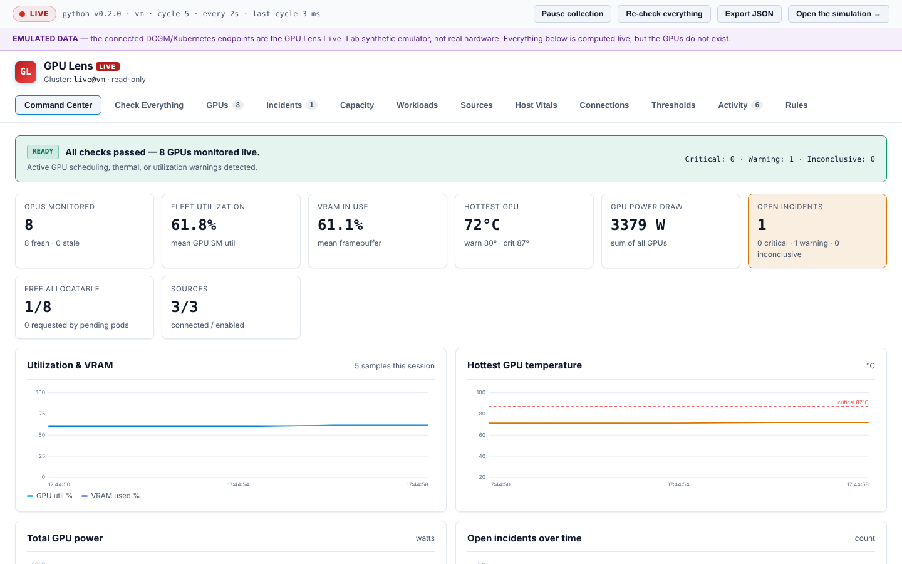
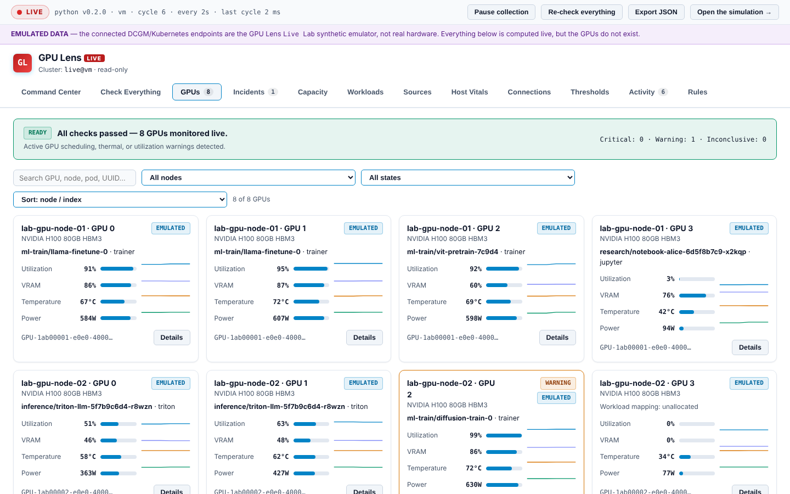

# GPU Lens — Open-Source GPU Fleet Reliability and Capacity Intelligence Platform

[](https://gpu-lens.onrender.com)
[](#-sponsor-this-project)
[](SECURITY.md)
[](#6-non-negotiable-safety--architecture-constraints)

**GPU Lens** is a self-hosted, strictly **read-only** console that tells you what your NVIDIA GPUs are doing *right now* and why something is wrong. It reads your GPUs through `nvidia-smi`, DCGM Exporter, Prometheus and the Kubernetes API, correlates the signals, and turns them into deterministic, evidence-backed incident reports and transparent capacity audits — no AI/LLM calls, no cluster changes, no guesswork.

It has two views, one click apart:

1. **Go Live** — the default. Real telemetry from this machine and your infrastructure, with a "check everything" preflight.
2. **Simulation** — six deterministic cluster scenarios you can explore with no GPU and no setup.

Try it: **<https://gpu-lens.onrender.com>** (the hosted copy has no GPUs, so Go Live honestly reports "no telemetry" there — use the **Simulation** button to explore, or run it on your own machine). The first load can take about a minute while the free host wakes up.

---

## 1. Go Live — real GPUs, checked end to end



Press nothing: GPU Lens opens on Go Live and immediately checks every source in parallel, every cycle. It then keeps collecting, merges the signals per GPU, and runs the same six rules on live data.

| You get | What it means |
| :-- | :-- |
| **Check Everything** preflight | Every layer graded pass / warn / fail with a plain-language reason and a hint on how to fix it: GPU Lens itself, host, local NVIDIA driver, DCGM, Prometheus, Kubernetes, and cross-source correlation |
| **GPU cards** | Utilization, VRAM, temperature, power, fan, P-state, throttle reasons, PCIe link, sparklines, and the processes or pods using each GPU |
| **Incidents with evidence** | Opened when a rule fires, tracked while it lasts, moved to a resolved log when it clears — never silently dropped |
| **Capacity, workloads, nodes, events** | Allocatable vs used GPUs, Pending pods, node health, warning events |
| **Trends** | Fleet utilization, VRAM, hottest GPU, power and open-incident history, per-GPU heat map |
| **Rules & Thresholds** | Change any rule threshold live and watch verdicts re-evaluate (the simulation is unaffected) |
| **Connections** | Point it at a DCGM exporter, Prometheus or Kubernetes API; tokens are write-only |
| **Export** | JSON snapshot of everything on screen |




**Missing data is never healthy.** A machine with no reachable telemetry reports *no telemetry*, a stale GPU is excluded from verdicts and raises an incident, and a metric that is not exported is shown as *not exported* — never as zero. Data from the built-in Live Lab test cluster is always labelled **EMULATED**.

Full guide, HTTP API and limits: [`docs/LIVE.md`](docs/LIVE.md).

---

## 2. Simulation — six scenarios, zero setup

Press **Open the simulation** (top right of Go Live) or open `/?view=demo`. Pick a scenario in the banner:

| # | Scenario | What it shows |
| :-- | :-- | :-- |
| 1 | Healthy cluster | The baseline: fresh telemetry, nothing firing |
| 2 | Pending GPU workloads | Capacity vs fragmentation vs `nodeSelector` mismatch |
| 3 | Hardware health & thermal warning | XID 48, row-remap failure, NVLink CRC, node allocatable drop |
| 4 | Persistently low utilization | Low SM use *with* VRAM residency shown as contradicting evidence |
| 5 | Workload failure correlation | XID 79 crash vs a healthy-GPU OOMKilled crash |
| 6 | Stale & uncorrelated telemetry | The blind-spot banner; missing data is never green |


---

## 3. How to use GPU Lens

Pick the line that matches what you want to do.

### A. "I just want to look around" (nothing to install)
Open **<https://gpu-lens.onrender.com>**, press **Open the simulation**, and walk through the six scenarios ([five-minute walkthrough](#9-five-minute-simulation-walkthrough)).

### B. "I want to see Go Live working, but I have no GPU"
You need Python 3.9+ only (the repo ships the compiled UI). Open two terminals in the repo folder:

```bash
# terminal 1 — a clearly-labelled SYNTHETIC 8-GPU cluster on the addresses GPU Lens probes by default
python scripts/live_lab.py

# terminal 2 — GPU Lens
python scripts/local_runtime_server.py --host 127.0.0.1 --port 8080 --static-dir web/dist --fixtures-dir fixtures
```

Open <http://localhost:8080>. Within seconds you see 8 emulated GPUs and a 12-minute storyline of incidents (thermal excursion, Pending 4-GPU job, XID 79 + pod crash, stalled exporter). With Go installed, `make live-lab` and `make live` do the same.

### C. "I have an NVIDIA GPU machine" (workstation, laptop, GPU server)
1. Confirm the driver works: run `nvidia-smi`.
2. Start GPU Lens on that machine (same command as terminal 2 above, without the Live Lab).
3. Open <http://localhost:8080> — your real GPUs appear on their own. Use `ssh -L 8080:localhost:8080 you@server` to view a remote server from your laptop.

`nvidia-smi` reports utilization, memory, temperature, power, fan, throttling, PCIe and per-process memory. It cannot report hardware-fault counters (Xid, NVLink, ECC violations), so GPU Lens tells you fault coverage is limited and suggests adding a DCGM exporter.

### D. "I run a GPU cluster (Kubernetes, DCGM, Prometheus)"
Give GPU Lens read-only access and point it at your sources — by flag, environment variable, or the **Connections** tab:

```bash
kubectl apply -f deploy/kubernetes/rbac-readonly.yaml          # get/list/watch on nodes, pods, events — nothing else
gpulens -mode live \
  -dcgm-url http://dcgm-exporter.gpu:9400/metrics \
  -prometheus-url http://prometheus.monitoring:9090 \
  -kubernetes-url https://kube-api:6443 -kubernetes-token-file /run/secrets/token -kubernetes-ca-file /run/secrets/ca.crt
```

Run inside the cluster under that service account and the Kubernetes API is detected automatically. `-mode live` starts collecting at boot, so it works as an always-on service with no browser attached.

### E. "I want it in Docker"
```bash
docker compose up --build        # http://localhost:8080 (published on 127.0.0.1 only)
```
Set `GPULENS_DCGM_EXPORTER_URL`, `GPULENS_PROMETHEUS_URL`, `GPULENS_KUBERNETES_URL` (see the commented lines in `docker-compose.yml`) to connect it.

### A typical session
1. Open **Go Live → Check Everything**: is every source healthy? Fix anything red using its hint.
2. **Command Center**: fleet verdict, hottest GPU, open incidents.
3. **Incidents**: read the evidence (supporting *and* contradicting) before acting.
4. **Capacity / Workloads**: who holds the GPUs, who is Pending and why.
5. **Rules & Thresholds**: tune a limit for your fleet and watch the verdicts change.
6. **Export JSON** to attach a snapshot to a ticket.

Both views have a white theme by default; the **Dark mode** button (bottom-left) switches and the browser remembers your choice. All flags and variables: [`docs/LIVE.md`](docs/LIVE.md).

---

## <a id="-sponsor-this-project"></a>💖 Sponsor this project

GPU Lens is free, open source and built on evenings and weekends. If it saved you an on-call page, a debugging afternoon, or a wasted GPU-hour, please consider supporting it — sponsorship pays for real-hardware test time, new telemetry adapters (AMD, MIG, DRA), and keeping the hosted demo online.

[](https://github.com/sponsors/mohityadav8)
[](https://buymeacoffee.com/ymohit7990c)

Other ways to help, all free:
- ⭐ **Star the repository** — it is how other GPU operators find it.
- 🧪 **Test it on real hardware** and open an issue with a screenshot of the *Check Everything* tab — Go Live has been verified against emulators and test doubles, so real-world reports are gold.
- 📣 **Share it** with whoever runs your GPUs.
- 🛠 **Contribute**: new rules, adapters and docs are welcome via pull request.

---

## 4. Why GPU Lens exists (problem statement)

Operators of GPU clouds, AI training clusters, and inference platforms collect telemetry across disconnected layers:
1. **GPU Hardware Telemetry** (`dcgm-exporter` / Prometheus): SM compute utilization (`DCGM_FI_DEV_GPU_UTIL`), memory copy utilization (`DCGM_FI_DEV_MEM_COPY_UTIL`), framebuffer occupancy (`DCGM_FI_DEV_FB_USED`), temperature (`DCGM_FI_DEV_GPU_TEMP`), power (`DCGM_FI_DEV_POWER_USAGE`), XID hardware error codes (`DCGM_FI_DEV_XID_ERRORS`), HBM row-remap failures (`DCGM_FI_DEV_ROW_REMAP_FAILURE`), PCIe replay counters (`DCGM_FI_DEV_PCIE_REPLAY_COUNTER`), and optional ECC / NVLink / throttling counters.
2. **Kubernetes Control Plane State**: `Node` `capacity` vs. `allocatable` GPU counts, Node Problem Detector conditions (`GPUXIDErrors`, `GPUClockThrottling`), `Pod` phases, container exit codes/restarts, and `FailedScheduling` / `BackOff` events.

When a distributed training job crashes, stalls in `Pending`, or holds expensive H100/A100 accelerators at low compute utilization, engineers must manually correlate timestamps, GPU UUIDs, PCI bus addresses, node conditions, and pod bindings across Prometheus and `kubectl`. Worse, missing Prometheus scrapes or broken kubelet `pod-resources` socket bindings can create silent monitoring blind spots where dashboards appear "green" simply because telemetry stopped arriving.

**GPU Lens solves this investigation bottleneck without replacing existing tools, calling external AI APIs, or mutating cluster state.**

---

## 5. Core Capabilities & Six Deterministic Diagnostic Rules

See [`RULES.md`](RULES.md) for full rule specifications, thresholds, and suppression logic:

| Rule ID | Rule Name | Use Case Addressed | Key Safeguards & Epistemic Discipline |
| :--- | :--- | :--- | :--- |
| **`GPU-SCHED-001`** | Pending GPU Workload Scheduling Bottleneck | **A. GPU Scheduling Diagnosis** | Distinguishes aggregate capacity exhaustion, multi-node GPU fragmentation, device plugin de-allocation (`allocatable < capacity`), and `nodeSelector`/taint mismatches. Marks `inconclusive` instead of guessing if `FailedScheduling` events and node inventory are missing. |
| **`GPU-HEALTH-002`** | GPU Hardware Fault or Health Degradation | **B. GPU Health & Performance Warnings** | Evaluates XID errors, row-remap failures, PCIe replay counters, optional ECC DBE (`DCGM_FI_DEV_ECC_DBE_VOL_TOTAL`), NVLink CRC errors, and node allocatable drops. Never fabricates findings for unexported optional metrics. |
| **`GPU-UTIL-003`** | Persistently Low GPU Compute Utilization | **C. Persistently Low Utilization** | Flags running pods with mean `DCGM_FI_DEV_GPU_UTIL < 15%` over `>= 60m` (`>= 6` samples). **Never labels low utilization as proven waste**; cross-checks VRAM residency (`DCGM_FI_DEV_FB_USED`) to highlight memory-capacity-bound workloads (e.g., 70B LLM inference) and outputs a 4-step engineering checklist. |
| **`GPU-CORR-004`** | Workload Failure / Restart Correlation | **D. Workload Failure Correlation** | Correlates container terminations (`exitCode`, `reason`, `finishedAt`) with GPU faults in `[-15m, +5m]`. Explicitly separates hardware-corroborated crashes (e.g., XID 79) from userspace `OOMKilled` crashes where healthy GPU telemetry is recorded as **contradicting evidence**. |
| **`GPU-FRESH-005`** | Telemetry Source Unavailable, Stale, or Uncorrelated | **E. Monitoring Data Freshness** | Detects unreachable scrape targets, stale GPU timestamps (`> 180s`), and allocated GPUs missing `pod`/`namespace` labels (`pod-resources` socket blind spot). Missing data never defaults to `Healthy`. |
| **`GPU-THERM-006`** | GPU Thermal, Power Brake, or Memory Pressure | **B. GPU Envelope Warnings** | Detects GPU core temp `>= 80°C` / `>= 87°C`, HBM memory temp `>= 90°C`, active thermal/power throttling violations, and `>= 95%` framebuffer memory pressure. |

---

## 6. Non-Negotiable Safety & Architecture Constraints

- **Zero AI / LLM / External SaaS Dependencies**: No OpenAI, Anthropic, Gemini, MCP servers, vector databases, or external SaaS calls. In demo mode there are no network calls at all; in Go Live, GPU Lens contacts only the telemetry endpoints you point it at (or the conventional local addresses). All diagnostics are deterministic rules and statistical summaries.
- **Strictly Read-Only Infrastructure Access**: Enforced at the Go interface level, HTTP transport level (`ReadOnlyRoundTripper` in `internal/source/readonly_transport.go` blocks `POST`, `PUT`, `PATCH`, `DELETE`), and Kubernetes RBAC level (`deploy/kubernetes/rbac-readonly.yaml`).
- **No Remediation, Minimal Read-Only Host Access**: Never runs invasive `dcgmi diag` stress tests and never kills jobs, drains nodes, or modifies scheduling. The single local command Go Live may run is `nvidia-smi` with a fixed allow-list of query flags (no shell, no state-changing options, 8 s timeout); it can be turned off with `--no-nvidia-smi`.
- **100% Offline Reproducibility**: Ships with 6 deterministic cluster scenarios (`fixtures/scenario_1_healthy.json` through `fixtures/scenario_6_stale_telemetry.json`) generated by `scripts/generate_fixtures.py`.

---

## 7. Repository Structure

```text
gpu-lens/
├── cmd/gpulens/main.go                  # Go backend entrypoint (CLI flags, config validation, graceful shutdown)
├── internal/
│   ├── domain/models.go                 # Normalized domain models (ClusterSnapshot, GPUDevice, Incident, CapacityReport)
│   ├── config/                          # Typed configuration, DCGM metric mappings, validation & token redaction + tests
│   ├── rules/                           # Extensible 6-rule deterministic engine, fingerprinting & table-driven tests
│   ├── capacity/                        # GPU capacity & low-utilization GPU-hour calculator + tests
│   ├── source/                          # Sources (Fixture, K8s Read-Only, Prometheus, DCGM Exporter, nvidia-smi, host vitals) + tests
│   ├── live/                            # Go Live engine: collection, per-GPU merge, windowed rules, incident lifecycle, preflight + tests
│   ├── store/                           # Incident deduplication & persistence store + tests
│   └── api/                             # HTTP REST handlers, middleware & API integration tests
├── web/                                 # React + TypeScript + Vite operator console
│   ├── src/                             # Typed TSX components (App.tsx, api.ts, types.ts, jsx-runtime.ts, styles.css)
│   ├── src/theme.ts                     # White/dark theme toggle (CSS-only; white by default)
│   ├── src/live/                        # Go Live console (LiveConsole, views, store, API client) — isolated from the simulation
│   ├── scripts/build_offline.js         # Offline TypeScript/TSX compiler using @babel/preset-typescript & preset-react
│   └── dist/                            # Compiled production frontend assets served by the backend
├── fixtures/                            # 6 checked-in deterministic JSON cluster scenarios
├── scripts/
│   ├── generate_fixtures.py             # Deterministic fixture generator (zero randomness)
│   ├── local_runtime_server.py          # Portable 1:1 local runtime & SQLite server for environments without Go installed
│   ├── gpulens_live.py                  # Python mirror of the Go Live engine (standard library only)
│   ├── live_lab.py                      # Live Lab: SYNTHETIC dcgm-exporter + Kubernetes API for trying Go Live without GPUs
│   └── run_verification_suite.py        # End-to-end automated unit & HTTP API verification suite
├── tests/live_blackbox.py               # Black-box Go Live tests against the Go and Python servers
├── tests/fixtures/fake-nvidia-smi       # nvidia-smi test double (canned answers, not a GPU tool)
├── .github/FUNDING.yml                  # Sponsor button (GitHub Sponsors, Buy Me a Coffee)
├── docs/LIVE.md                         # Go Live guide, API reference, honest limits
├── config/example-config.yaml           # Documented example configuration & metric mappings
├── deploy/kubernetes/rbac-readonly.yaml # Minimum read-only Kubernetes RBAC manifest
├── docs/screenshots/                    # Authentic screenshots captured from the running application
├── RESEARCH.md                          # Phase 1 Research Report with cited sources and gap analysis
├── ARCHITECTURE.md                      # System diagram, layer boundaries, and 5 ADRs
├── SECURITY.md                          # Security policy, RBAC boundaries, and STRIDE threat model
├── RULES.md                             # Complete specification of all 6 diagnostic rules
├── Dockerfile                           # Multi-stage non-root container build
├── docker-compose.yml                   # Local demonstration Compose stack
├── Makefile                             # Developer workflow commands
└── .github/workflows/ci.yml             # Automated CI pipeline
```

---

## 8. Quickstart & Exact Run Commands

### Option A: Run Directly (Works Offline With or Without Go Installed)

```bash
# 1. Generate deterministic offline fixtures and compile the TypeScript/TSX frontend
make fixtures frontend

# 2. Run the automated verification and test suite
make test

# 3. Start the GPU Lens server on http://127.0.0.1:8080
make demo
```

If you have Go 1.22+ installed on your workstation:
```bash
gofmt -s -w cmd/ internal/
go vet ./...
go test -v -race ./...
go run ./cmd/gpulens -listen :8080 -mode fixture -fixtures-dir ./fixtures -static-dir ./web/dist
```

### Go Live

```bash
make demo                      # http://127.0.0.1:8080 — opens on Go Live; the Simulation is one click away
python3 scripts/live_lab.py    # optional: a synthetic GPU cluster to point Go Live at (no GPUs needed)
make live                      # or start already collecting: go run ./cmd/gpulens -mode live
make test-live                 # black-box tests of the live API on the Go and Python backends
```

On a GPU machine Go Live finds `nvidia-smi` by itself; point it at DCGM / Prometheus / Kubernetes with the flags and `GPULENS_*` variables in [`docs/LIVE.md`](docs/LIVE.md) or the **Connections** tab.

### Option B: Run via Docker Compose

```bash
docker compose up --build
# Open http://localhost:8080
```

---

## 9. Five-Minute Simulation Walkthrough

Once the server is running on `http://localhost:8080`, press **Open the simulation** (top right; or open `/?view=demo`), then use the **Active Scenario** selector in the top banner to walk through all six operational scenarios in five minutes:

1. **Minute 1 — Baseline Healthy Fleet (`1. Healthy Cluster`)**:
   - Select **1. Healthy Cluster (No Active Incidents)**.
   - Observe on **Overview** that 8/8 H100 GPUs are allocatable, 6 are allocated across `llama3-pretrain-rank-0` and `vllm-mistral-serve-0`, mean utilization is `83.9%`, telemetry is fresh (`15s`), and **Active Diagnostic Findings = 0**.
2. **Minute 2 — Pending GPU Workloads (`2. Pending GPU Workloads`)**:
   - Switch to **2. Pending GPU Workloads (Capacity & Fragmentation)**.
   - Observe two `GPU-SCHED-001` findings: `llama3-70b-finetune-master-0` (requesting 4 GPUs when only 3 free GPUs exist fragmented as 1 + 2 across two nodes) and `blackwell-fp4-benchmark-0` (blocked by `nodeSelector: nvidia.com/gpu.product=NVIDIA-B200`).
3. **Minute 3 — Hardware Faults & Thermal Throttling (`3. GPU Hardware Health & Thermal Warning`)**:
   - Switch to **3. GPU Hardware Health & Thermal Warning**.
   - Click **Inspect** on `GPU-HEALTH-002` to see `XID 48 (Double Bit ECC Error)`, `DCGM_FI_DEV_ROW_REMAP_FAILURE=1`, `DCGM_FI_DEV_ECC_DBE_VOL_TOTAL=2`, NVLink CRC errors, Node Problem Detector `GPUXIDErrors=True`, and node allocatable GPUs reduced from `4` to `3`.
4. **Minute 4 — Persistent Low Utilization & VRAM Context (`4. Persistently Low GPU Utilization`)**:
   - Switch to **4. Persistently Low GPU Utilization** and open the **Capacity & Utilization** tab.
   - Compare the two flagged workloads: `jupyter-research-dev-0` (`3.96%` SM compute, `4.6%` VRAM) vs. `llama3-70b-int8-realtime-0` (`7.56%` SM compute, **`91.55%` VRAM residency**). Inspect the incident detail to see how high VRAM residency is recorded as **Contradicting Evidence** against naive downsizing, alongside the transparent calculation of `6.0 GPU-hours` below threshold and the clearly labeled illustrative sample cost estimate.
5. **Minute 5 — Failure Correlation & Blind Spots (`5. Workload Failure Correlation` & `6. Stale & Uncorrelated Telemetry`)**:
   - Switch to **5. Workload Failure Correlation**: inspect how `GPU-CORR-004` differentiates `multimodal-train-worker-0` (crashed 105s after `XID 79: GPU has fallen off the bus` on `GPU-h100-n01-0` — **Critical / Strong Evidence**) from `dataloader-oom-job-0` (crashed with `ExitCode 137 / OOMKilled` while its assigned GPUs had zero hardware errors — **Warning / Contradicting Hardware Evidence**).
   - Finally, switch to **6. Stale & Uncorrelated Telemetry**: observe the purple `TELEMETRY BLIND SPOT` fleet banner, where `gpu-node-02` telemetry is `840s` stale (causing the failure correlation for `distributed-rlhf-worker-1` to be marked **`INCONCLUSIVE`** rather than healthy) and `gpu-node-01` GPUs are flagged for missing Kubernetes pod labels (`pod-resources` socket blind spot).

---

## 10. What GPU Lens Does Not Yet Support (Known Limitations)

0. **Go Live was built and tested without GPU hardware.** The `nvidia-smi` adapter ran against a test double, and the DCGM / Kubernetes adapters against the Live Lab emulator and Go `httptest` servers; Prometheus against `httptest` only. Expect a first-run shake-down on real hardware. The Python runtime reads Prometheus with a single instant query (no backfill, no target audit, no clock-skew check).

1. **No Multi-Cluster Aggregation**: Each GPU Lens instance evaluates a single Kubernetes cluster and its associated Prometheus/DCGM telemetry pool.
2. **No MIG Combinatorial Packing or DRA Topology Solver**: While GPU Lens parses GPU series and labels, capacity calculations model integer `nvidia.com/gpu` allocations rather than combinatorial Multi-Instance GPU (`GPU_I_PROFILE`) slice geometry or Kubernetes Dynamic Resource Allocation (`ResourceClaim`) graphs.
3. **No Direct Host `dmesg` or InfiniBand Switch Scraper**: Hardware fault detection relies on metrics exported via DCGM Exporter / Prometheus and Kubernetes Node conditions/events (such as Node Problem Detector). InfiniBand fabric errors or PCIe drops that do not surface in DCGM or Kubernetes events are only observable indirectly via telemetry staleness or pod failures.
4. **No Automated Remediation by Design**: GPU Lens intentionally never cordons nodes, drains workloads, resets GPUs, or kills pods. For automated fault quarantine and break-fix workflows, see [NVIDIA NVSentinel](https://docs.nvidia.com/nvsentinel/getting-started/overview/).
