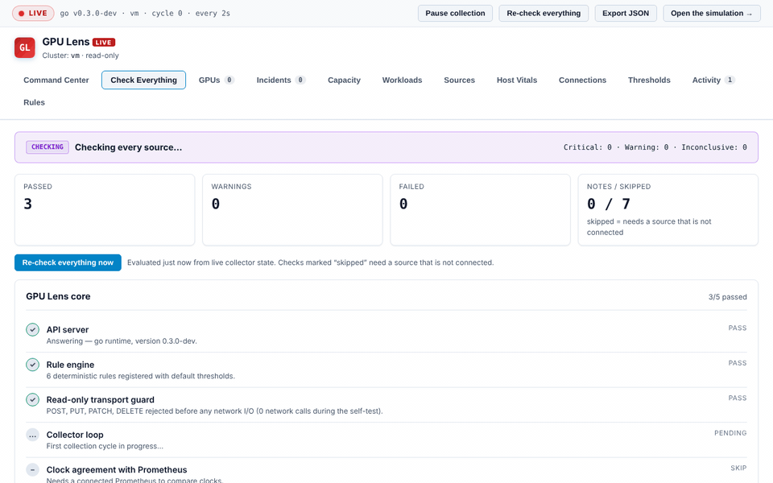
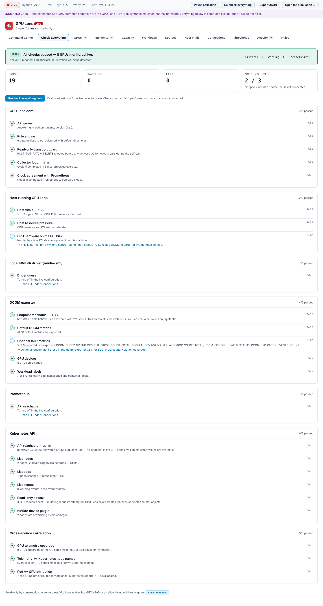
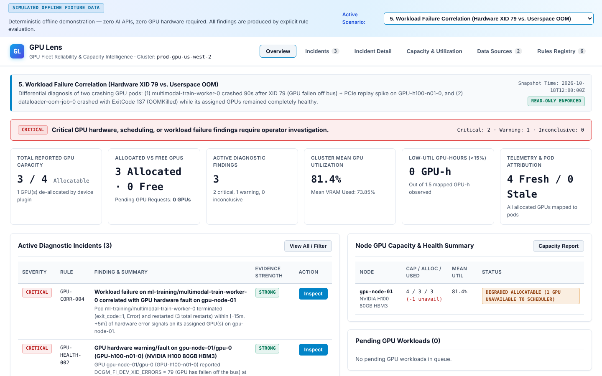
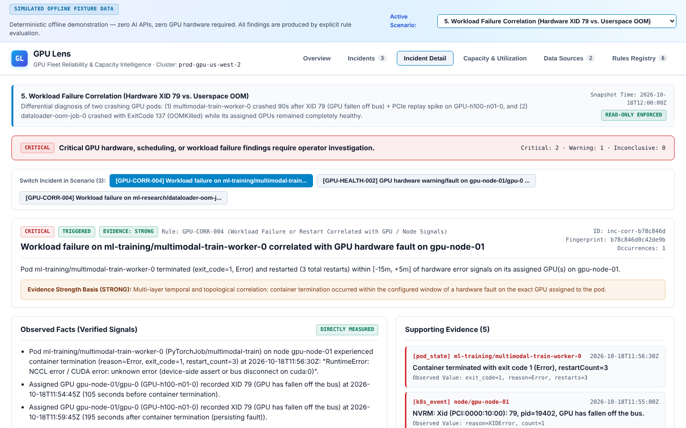
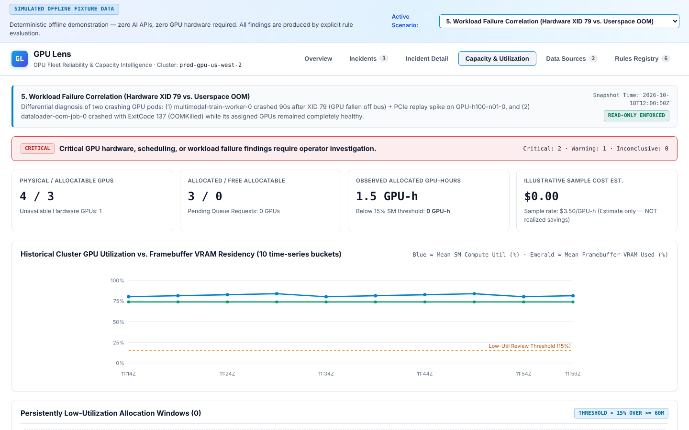
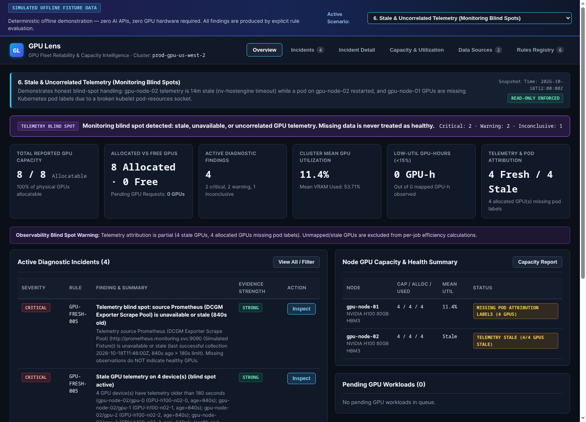
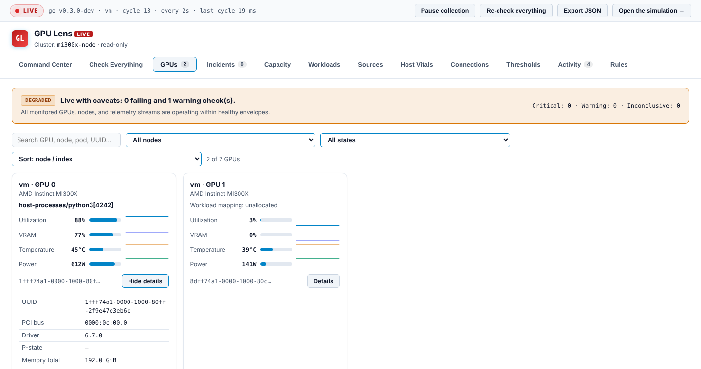
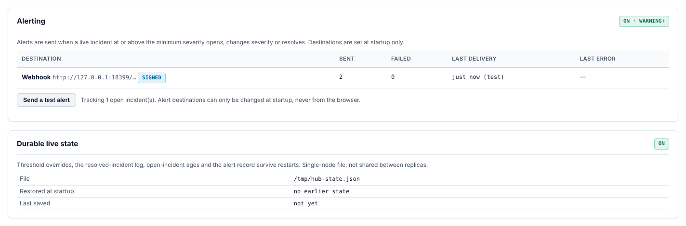

# GPU Lens — Open-Source GPU Fleet Reliability and Capacity Intelligence Platform

[](https://github.com/Sievehouse/gpu-lens/actions/workflows/ci.yml)
[](https://github.com/Sievehouse/gpu-lens/actions/workflows/codeql.yml)
[](https://github.com/Sievehouse/gpu-lens/actions/workflows/container.yml)
[](https://scorecard.dev/viewer/?uri=github.com/Sievehouse/gpu-lens)
[](LICENSE)
[](https://gpu-lens.onrender.com)
[](SECURITY.md)
[](#-sponsor-this-project)

**GPU Lens** is a self-hosted, strictly **read-only** console that tells you what your GPUs are doing *right now* and why something is wrong. It reads NVIDIA GPUs through `nvidia-smi`, DCGM Exporter, Prometheus and the Kubernetes API (and AMD GPUs through `amd-smi`, experimental), correlates the signals, and turns them into deterministic, evidence-backed incidents and transparent capacity audits. No AI/LLM calls, no cluster changes, no guesswork.

It has two views, one click apart:

1. **Go Live** — the default. Real telemetry from this machine, your cluster, or a whole fleet of clusters, with a "check everything" preflight, alerts and an audit trail.
2. **Simulation** — six deterministic cluster scenarios you can explore with no GPU and no setup.

Try it: **<https://gpu-lens.onrender.com>** (the hosted copy has no GPUs, so Go Live honestly reports "no telemetry" there — use the **Simulation** button to explore, or run it on your own machine). The first load can take about a minute while the free host wakes up.



---

## 1. Go Live — real GPUs, checked end to end


Press nothing: GPU Lens opens on Go Live and immediately checks every source in parallel, every cycle. It then keeps collecting, merges the signals per GPU, and runs the same six rules on live data.

| You get | What it means |
| :-- | :-- |
| **Check Everything** preflight | Every layer graded pass / warn / fail with a plain-language reason and a hint on how to fix it: GPU Lens itself, host, local NVIDIA and AMD drivers, DCGM, Prometheus, Kubernetes, and cross-source correlation |
| **GPU cards** | Utilization, VRAM, temperature, power, fan, P-state, throttle reasons, PCIe link, sparklines, and the processes or pods using each GPU |
| **Incidents with evidence** | Opened when a rule fires, tracked while it lasts, moved to a resolved log when it clears — never silently dropped |
| **Alerts** | Slack and/or a signed JSON webhook when an incident opens, changes severity or resolves ([docs/ALERTING.md](docs/ALERTING.md)) |
| **Fleet** | One hub shows every GPU Lens instance — each cluster or GPU host — side by side ([docs/FLEET.md](docs/FLEET.md)) |
| **Access control & audit** | Basic auth with an admin and a read-only viewer role; every threshold, connection and scenario change is recorded ([docs/AUTH.md](docs/AUTH.md)) |
| **Capacity, workloads, nodes, events** | Allocatable vs used GPUs, Pending pods, node health, warning events |
| **Trends** | Fleet utilization, VRAM, hottest GPU, power and open-incident history, per-GPU heat map |
| **Rules & Thresholds** | Change any rule threshold live and watch verdicts re-evaluate (the simulation is unaffected) |
| **Durable state** | Thresholds, resolved incidents and alert history survive restarts (`-live-state-file`) |
| **Self-metrics** | `/metrics` in Prometheus format: is GPU Lens itself collecting, which sources are up, alerts delivered |
| **Export** | JSON snapshot of everything on screen; [OpenAPI spec](docs/openapi.yaml) for every endpoint |




**Missing data is never healthy.** A machine with no reachable telemetry reports *no telemetry*, a stale GPU is excluded from verdicts and raises an incident, an unreachable fleet member is shown as unreachable, and a metric a source does not publish is shown as *not exported* — never as zero. Data from the built-in Live Lab test cluster is always labelled **EMULATED**.

Full guide, HTTP API and limits: [`docs/LIVE.md`](docs/LIVE.md).

---

## 2. Simulation — six scenarios, zero setup

Press **Open the simulation** (top right of Go Live) or open `/?view=demo`. Pick a scenario in the banner:

| # | Scenario | What it shows |
| :-- | :-- | :-- |
| 1 | Healthy cluster | The baseline: fresh telemetry, nothing firing |
| 2 | Pending GPU workloads | Capacity vs fragmentation vs `nodeSelector` mismatch |
| 3 | Hardware health & thermal warning | XID 48, row-remap failure, NVLink CRC, node allocatable drop |
| 4 | Persistently low utilization | Low SM use *with* VRAM residency shown as contradicting evidence |
| 5 | Workload failure correlation | XID 79 crash vs a healthy-GPU OOMKilled crash |
| 6 | Stale & uncorrelated telemetry | The blind-spot banner; missing data is never green |









---

## 3. How GPU Lens compares

GPU Lens does not replace your metrics stack; it reads it. The question it answers is *"what is wrong right now, and what is the evidence?"*

| | **GPU Lens** | **DCGM exporter + Grafana** | **NVIDIA NVSentinel** | **nvitop** |
| :-- | :-- | :-- | :-- | :-- |
| What it is | Diagnosis console: deterministic incidents with supporting *and* contradicting evidence | Metrics pipeline and dashboards | Kubernetes services that detect, classify and remediate GPU node faults | Interactive NVIDIA GPU and process viewer in the terminal |
| Correlates GPU faults with pod crashes, Pending pods and stale telemetry | Yes, out of the box (6 rules) | You build the panels and alert rules; correlation is manual | Classifies node faults for remediation | No — one machine's devices and processes |
| Changes your infrastructure | **Never** (read-only transport, read-only RBAC) | No | Yes, by design: cordon, drain, GPU reset or reboot (remediation modules are opt-in) | Can signal/kill processes (has a `--readonly` mode) |
| Missing telemetry | Reported as a blind spot, never as healthy | Panels go empty | — | — |
| Scope | One GPU host up to many clusters (fleet hub) | Whatever Prometheus scrapes | One Kubernetes cluster per install | One machine |
| Works with no GPU | Yes: simulation + Live Lab emulator | No | Yes: fault-injection demo in kind | No |
| Setup | Single binary, Docker, or Helm | Exporter + Prometheus + Grafana + dashboards | Helm, per cluster | `pip install nvitop` |

They work well together: point GPU Lens at the DCGM exporter and Prometheus you already run; let NVSentinel automate remediation while GPU Lens explains what happened; use nvitop for hands-on process management on a single box.

---

## 4. How to use GPU Lens

Pick the line that matches what you want to do.

### A. "I just want to look around" (nothing to install)
Open **<https://gpu-lens.onrender.com>**, press **Open the simulation**, and walk through the six scenarios ([five-minute walkthrough](#10-five-minute-simulation-walkthrough)).

### B. "I want to see Go Live working, but I have no GPU"
You need Python 3.9+ only (the repo ships the compiled UI). Open two terminals in the repo folder:

```bash
# terminal 1 — a clearly-labelled SYNTHETIC 8-GPU cluster on the addresses GPU Lens probes by default
python scripts/live_lab.py

# terminal 2 — GPU Lens
python scripts/local_runtime_server.py --host 127.0.0.1 --port 8080 --static-dir web/dist --fixtures-dir fixtures
```

Open <http://localhost:8080>. Within seconds you see 8 emulated GPUs and a 12-minute storyline of incidents (thermal excursion, Pending 4-GPU job, XID 79 + pod crash, stalled exporter). With Go installed, `make live-lab` and `make live` do the same.

### C. "I have an NVIDIA GPU machine" (workstation, laptop, GPU server)
1. Confirm the driver works: run `nvidia-smi`.
2. Start GPU Lens on that machine (same command as terminal 2 above, without the Live Lab), or download a [release binary](https://github.com/Sievehouse/gpu-lens/releases).
3. Open <http://localhost:8080> — your real GPUs appear on their own. Use `ssh -L 8080:localhost:8080 you@server` to view a remote server from your laptop.

`nvidia-smi` reports utilization, memory, temperature, power, fan, throttling, PCIe and per-process memory. It cannot report hardware-fault counters (Xid, NVLink, PCIe replay), so the GPU details show those as *not exported* and Check Everything suggests adding a DCGM exporter.

### D. "I have AMD GPUs" (experimental)
Install ROCm (it ships `amd-smi`) and start GPU Lens as in C — it finds `amd-smi` in `PATH` or `/opt/rocm/bin` (or pass `-amd-smi-path`). Utilization, VRAM, temperature (edge, or hotspot on Instinct parts), power, ECC counts, PCIe link and processes are read. AMD support has been verified against a test double built from AMD's documented JSON output, not yet on real hardware — reports are very welcome.



### E. "I run a GPU cluster (Kubernetes, DCGM, Prometheus)"
With Helm (read-only RBAC included):

```bash
helm install gpulens deploy/helm/gpulens -n gpu-lens --create-namespace \
  --set sources.dcgmExporterUrl=http://nvidia-dcgm-exporter.gpu-operator.svc:9400/metrics \
  --set sources.prometheusUrl=http://prometheus-operated.monitoring.svc:9090 \
  --set auth.enabled=true --set auth.adminPassword='change-me-please' \
  --set persistence.enabled=true
kubectl -n gpu-lens port-forward svc/gpulens 8080:8080
```

Or run the binary/container yourself with flags (`-mode live -dcgm-url … -prometheus-url … -kubernetes-url …`) after `kubectl apply -f deploy/kubernetes/rbac-readonly.yaml`. Inside the cluster the service account is detected automatically, and `-mode live` keeps collecting with no browser attached.

### F. "I want it in Docker"
```bash
docker compose up --build                                   # build locally; http://localhost:8080 (127.0.0.1 only)
docker run --rm -p 127.0.0.1:8080:8080 ghcr.io/sievehouse/gpu-lens:latest   # published image (linux/amd64, linux/arm64)
```
Set `GPULENS_DCGM_EXPORTER_URL`, `GPULENS_PROMETHEUS_URL`, `GPULENS_KUBERNETES_URL` (see the commented lines in `docker-compose.yml`) to connect it.

### G. "My team will use it" — auth, roles, audit
```bash
gpulens -mode live -basic-auth-user admin -basic-auth-pass-file /run/secrets/admin \
        -viewer-user oncall -viewer-pass-file /run/secrets/viewer \
        -audit-log-file /var/lib/gpulens/audit.jsonl -live-state-file /var/lib/gpulens/live.json
```
Admins can change thresholds, connections and collection; viewers can watch everything. Every change (and every refused attempt) is in the audit log and the **Activity → Audit** filter. Put TLS in front — see [docs/AUTH.md](docs/AUTH.md) for nginx and oauth2-proxy patterns.

### H. "Tell me in Slack when something breaks"
```bash
gpulens -mode live -alert-slack-webhook https://hooks.slack.com/services/… -public-url https://gpulens.example.com
```
Or `-alert-webhook-url` with `-alert-webhook-secret-file` for a signed JSON payload (PagerDuty, Opsgenie, your own service). Press **Connections → Send a test alert** to check delivery. Details: [docs/ALERTING.md](docs/ALERTING.md).



### I. "I have several clusters"
Run one GPU Lens per cluster (or GPU host), then on any of them add `-peer name=https://gpulens.cluster-b:8080` for each other instance. The **Fleet** tab shows them all; unreachable members are flagged, not hidden. Details: [docs/FLEET.md](docs/FLEET.md).

### A typical session
1. Open **Go Live → Check Everything**: is every source healthy? Fix anything red using its hint.
2. **Command Center** (or **Fleet** across clusters): verdict, hottest GPU, open incidents.
3. **Incidents**: read the evidence (supporting *and* contradicting) before acting.
4. **Capacity / Workloads**: who holds the GPUs, who is Pending and why.
5. **Rules & Thresholds**: tune a limit for your fleet and watch the verdicts change (audited).
6. **Export JSON** to attach a snapshot to a ticket.

Both views have a white theme by default; the **Dark mode** button (bottom-left) switches and the browser remembers your choice. All flags and variables: [`docs/LIVE.md`](docs/LIVE.md).

---

## 5. Why GPU Lens exists (problem statement)

Operators of GPU clouds, AI training clusters, and inference platforms collect telemetry across disconnected layers:
1. **GPU Hardware Telemetry** (`dcgm-exporter` / Prometheus): SM compute utilization (`DCGM_FI_DEV_GPU_UTIL`), memory copy utilization (`DCGM_FI_DEV_MEM_COPY_UTIL`), framebuffer occupancy (`DCGM_FI_DEV_FB_USED`), temperature (`DCGM_FI_DEV_GPU_TEMP`), power (`DCGM_FI_DEV_POWER_USAGE`), XID hardware error codes (`DCGM_FI_DEV_XID_ERRORS`), HBM row-remap failures (`DCGM_FI_DEV_ROW_REMAP_FAILURE`), PCIe replay counters (`DCGM_FI_DEV_PCIE_REPLAY_COUNTER`), and optional ECC / NVLink / throttling counters.
2. **Kubernetes Control Plane State**: `Node` `capacity` vs. `allocatable` GPU counts, Node Problem Detector conditions (`GPUXIDErrors`, `GPUClockThrottling`), `Pod` phases, container exit codes/restarts, and `FailedScheduling` / `BackOff` events.

When a distributed training job crashes, stalls in `Pending`, or holds expensive H100/A100 accelerators at low compute utilization, engineers must manually correlate timestamps, GPU UUIDs, PCI bus addresses, node conditions, and pod bindings across Prometheus and `kubectl`. Worse, missing Prometheus scrapes or broken kubelet `pod-resources` socket bindings can create silent monitoring blind spots where dashboards appear "green" simply because telemetry stopped arriving.

**GPU Lens solves this investigation bottleneck without replacing existing tools, calling external AI APIs, or mutating cluster state.**

---

## 6. Core Capabilities & Six Deterministic Diagnostic Rules

See [`RULES.md`](RULES.md) for full rule specifications, thresholds, and suppression logic:

| Rule ID | Rule Name | Use Case Addressed | Key Safeguards & Epistemic Discipline |
| :--- | :--- | :--- | :--- |
| **`GPU-SCHED-001`** | Pending GPU Workload Scheduling Bottleneck | **A. GPU Scheduling Diagnosis** | Distinguishes aggregate capacity exhaustion, multi-node GPU fragmentation, device plugin de-allocation (`allocatable < capacity`), and `nodeSelector`/taint mismatches. Marks `inconclusive` instead of guessing if `FailedScheduling` events and node inventory are missing. |
| **`GPU-HEALTH-002`** | GPU Hardware Fault or Health Degradation | **B. GPU Health & Performance Warnings** | Evaluates XID errors, row-remap failures, PCIe replay counters, optional ECC DBE (`DCGM_FI_DEV_ECC_DBE_VOL_TOTAL`), NVLink CRC errors, and node allocatable drops. Never fabricates findings for unexported optional metrics. |
| **`GPU-UTIL-003`** | Persistently Low GPU Compute Utilization | **C. Persistently Low Utilization** | Flags running pods with mean `DCGM_FI_DEV_GPU_UTIL < 15%` over `>= 60m` (`>= 6` samples). **Never labels low utilization as proven waste**; cross-checks VRAM residency (`DCGM_FI_DEV_FB_USED`) to highlight memory-capacity-bound workloads (e.g., 70B LLM inference) and outputs a 4-step engineering checklist. |
| **`GPU-CORR-004`** | Workload Failure / Restart Correlation | **D. Workload Failure Correlation** | Correlates container terminations (`exitCode`, `reason`, `finishedAt`) with GPU faults in `[-15m, +5m]`. Explicitly separates hardware-corroborated crashes (e.g., XID 79) from userspace `OOMKilled` crashes where healthy GPU telemetry is recorded as **contradicting evidence**. |
| **`GPU-FRESH-005`** | Telemetry Source Unavailable, Stale, or Uncorrelated | **E. Monitoring Data Freshness** | Detects unreachable scrape targets, stale GPU timestamps (`> 180s`), and allocated GPUs missing `pod`/`namespace` labels (`pod-resources` socket blind spot). Missing data never defaults to `Healthy`. |
| **`GPU-THERM-006`** | GPU Thermal, Power Brake, or Memory Pressure | **B. GPU Envelope Warnings** | Detects GPU core temp `>= 80°C` / `>= 87°C`, HBM memory temp `>= 90°C`, active thermal/power throttling violations, and `>= 95%` framebuffer memory pressure. |

---

## 7. Non-Negotiable Safety & Architecture Constraints

- **Zero AI / LLM / External SaaS Dependencies**: No OpenAI, Anthropic, Gemini, MCP servers, vector databases, or external SaaS calls. In demo mode there are no network calls at all; in Go Live, GPU Lens contacts only the telemetry endpoints you point it at (or the conventional local addresses). All diagnostics are deterministic rules and statistical summaries.
- **Strictly Read-Only Infrastructure Access**: Enforced at the Go interface level, HTTP transport level (`ReadOnlyRoundTripper` in `internal/source/readonly_transport.go` blocks `POST`, `PUT`, `PATCH`, `DELETE`), and Kubernetes RBAC level (`deploy/kubernetes/rbac-readonly.yaml`, also in the Helm chart). Fleet hubs read peers with the same GET-only transport.
- **One opt-in outbound write — alerts**: when, and only when, an operator configures a Slack or webhook destination at startup, incident alerts are POSTed there. Destinations can never be set from the browser or API, redirects are not followed, and Slack URLs are never displayed.
- **No Remediation, Minimal Read-Only Host Access**: Never runs invasive `dcgmi diag` stress tests and never kills jobs, drains nodes, or modifies scheduling. The only local commands Go Live may run are `nvidia-smi` and `amd-smi` with fixed allow-lists of read-only query arguments (no shell, no state-changing options, 8 s timeout); turn them off with `-no-nvidia-smi` / `-no-amd-smi`.
- **100% Offline Reproducibility**: Ships with 6 deterministic cluster scenarios (`fixtures/scenario_1_healthy.json` through `fixtures/scenario_6_stale_telemetry.json`) generated by `scripts/generate_fixtures.py`.

---

## 8. Repository Structure

```text
gpu-lens/
├── cmd/gpulens/main.go                  # Go backend entrypoint (flags, env, config validation, graceful shutdown)
├── internal/
│   ├── domain/models.go                 # Normalized domain models (ClusterSnapshot, GPUDevice, Incident, CapacityReport)
│   ├── config/                          # Typed configuration, DCGM metric mappings, validation & token redaction + tests
│   ├── rules/                           # Extensible 6-rule deterministic engine, fingerprinting & table-driven tests
│   ├── capacity/                        # GPU capacity & low-utilization GPU-hour calculator + tests
│   ├── source/                          # Sources: fixtures, Kubernetes, Prometheus, DCGM exporter, nvidia-smi, amd-smi, host vitals + tests
│   ├── live/                            # Go Live engine: collection, per-GPU merge, rules, incident lifecycle, preflight, durable state + tests
│   ├── alert/                           # Slack + signed webhook notifier (open / resolve / severity change) + tests
│   ├── audit/                           # Audit log (memory + JSON-lines file) + tests via the API
│   ├── fleet/                           # Multi-cluster hub: polls peers' /api/v1/live/summary + tests
│   ├── store/                           # Simulation incident deduplication & persistence store + tests
│   └── api/                             # HTTP handlers, basic auth & roles, /metrics, security headers + tests
├── web/                                 # Operator console: TypeScript + TSX on a small built-in JSX runtime (no framework)
│   ├── src/                             # Simulation UI (App.tsx, api.ts, types.ts, jsx-runtime.ts, styles.css)
│   ├── src/theme.ts                     # White/dark theme toggle (CSS-only; white by default)
│   ├── src/live/                        # Go Live console (LiveConsole, views, store, API client) — isolated from the simulation
│   ├── scripts/build_offline.js         # Bundler: compiles every module with the TypeScript compiler
│   └── dist/                            # Compiled frontend served by the backend (committed: Render serves it as-is)
├── fixtures/                            # 6 checked-in deterministic JSON cluster scenarios
├── scripts/
│   ├── generate_fixtures.py             # Deterministic fixture generator (zero randomness)
│   ├── local_runtime_server.py          # Python runtime: same API as the Go binary, for machines without Go
│   ├── gpulens_live.py                  # Python mirror of the live engine, alerting, audit, auth, fleet, /metrics (stdlib only)
│   ├── live_lab.py                      # Live Lab: SYNTHETIC dcgm-exporter + Kubernetes API for trying Go Live without GPUs
│   └── run_verification_suite.py        # End-to-end verification suite
├── tests/live_blackbox.py               # Black-box tests against the Go and Python servers (both must pass)
├── tests/fixtures/fake-nvidia-smi       # nvidia-smi test double (canned answers, not a GPU tool)
├── tests/fixtures/fake-amd-smi          # amd-smi test double (AMD's documented JSON layouts)
├── deploy/helm/gpulens/                 # Helm chart (read-only RBAC, auth/alert secrets, PVC, Ingress, ServiceMonitor)
├── deploy/kubernetes/rbac-readonly.yaml # Minimum read-only Kubernetes RBAC manifest
├── docs/LIVE.md                         # Go Live guide, flags, environment variables, honest limits
├── docs/AUTH.md · ALERTING.md · FLEET.md # Access control & audit, alerting, multi-cluster
├── docs/openapi.yaml                    # OpenAPI 3.1 spec for every endpoint
├── docs/screenshots/                    # Screenshots and the README GIF, captured from the running application
├── .github/                             # CI, CodeQL, Trivy image scan, Scorecard, releases, Dependabot, templates, FUNDING.yml
├── .goreleaser.yaml                     # Release binaries (Linux, macOS, Windows × amd64, arm64)
├── RESEARCH.md · ARCHITECTURE.md · RULES.md · SECURITY.md · ROADMAP.md · CHANGELOG.md · CONTRIBUTING.md
├── Dockerfile                           # Multi-stage, non-root, multi-arch container build
├── docker-compose.yml                   # Local Compose stack (published on 127.0.0.1 only)
└── Makefile                             # Developer workflow commands
```

---

## 9. Quickstart & Exact Run Commands

### Option A: Run Directly (Works Offline With or Without Go Installed)

```bash
# 1. Generate deterministic offline fixtures and compile the TypeScript/TSX frontend
make fixtures frontend

# 2. Run the automated verification and test suite
make test

# 3. Start the GPU Lens server on http://127.0.0.1:8080
make demo
```

If you have Go 1.22+ installed on your workstation:
```bash
gofmt -s -w cmd/ internal/
go vet ./...
go test -race ./...
go run ./cmd/gpulens -listen 127.0.0.1:8080 -mode fixture -fixtures-dir ./fixtures -static-dir ./web/dist
```

### Go Live

```bash
make demo                      # http://127.0.0.1:8080 — opens on Go Live; the Simulation is one click away
python3 scripts/live_lab.py    # optional: a synthetic GPU cluster to point Go Live at (no GPUs needed)
make live                      # or start already collecting: go run ./cmd/gpulens -mode live
make test-live                 # black-box tests of the live API on the Go and Python backends
```

On a GPU machine Go Live finds `nvidia-smi` / `amd-smi` by itself; point it at DCGM / Prometheus / Kubernetes with the flags and `GPULENS_*` variables in [`docs/LIVE.md`](docs/LIVE.md) or the **Connections** tab.

### Option B: Docker, Helm, or a release

```bash
docker compose up --build                       # Docker (local build)
helm install gpulens deploy/helm/gpulens        # Kubernetes
make release-snapshot                           # build release archives locally (needs goreleaser)
```

---

## 10. Five-Minute Simulation Walkthrough

Once the server is running on `http://localhost:8080`, press **Open the simulation** (top right; or open `/?view=demo`), then use the **Active Scenario** selector in the top banner to walk through all six operational scenarios in five minutes:

1. **Minute 1 — Baseline Healthy Fleet (`1. Healthy Cluster`)**:
   - Select **1. Healthy Cluster (No Active Incidents)**.
   - Observe on **Overview** that 8/8 H100 GPUs are allocatable, 6 are allocated across `llama3-pretrain-rank-0` and `vllm-mistral-serve-0`, mean utilization is `83.9%`, telemetry is fresh (`15s`), and **Active Diagnostic Findings = 0**.
2. **Minute 2 — Pending GPU Workloads (`2. Pending GPU Workloads`)**:
   - Switch to **2. Pending GPU Workloads (Capacity & Fragmentation)**.
   - Observe two `GPU-SCHED-001` findings: `llama3-70b-finetune-master-0` (requesting 4 GPUs when only 3 free GPUs exist fragmented as 1 + 2 across two nodes) and `blackwell-fp4-benchmark-0` (blocked by `nodeSelector: nvidia.com/gpu.product=NVIDIA-B200`).
3. **Minute 3 — Hardware Faults & Thermal Throttling (`3. GPU Hardware Health & Thermal Warning`)**:
   - Switch to **3. GPU Hardware Health & Thermal Warning**.
   - Click **Inspect** on `GPU-HEALTH-002` to see `XID 48 (Double Bit ECC Error)`, `DCGM_FI_DEV_ROW_REMAP_FAILURE=1`, `DCGM_FI_DEV_ECC_DBE_VOL_TOTAL=2`, NVLink CRC errors, Node Problem Detector `GPUXIDErrors=True`, and node allocatable GPUs reduced from `4` to `3`.
4. **Minute 4 — Persistent Low Utilization & VRAM Context (`4. Persistently Low GPU Utilization`)**:
   - Switch to **4. Persistently Low GPU Utilization** and open the **Capacity & Utilization** tab.
   - Compare the two flagged workloads: `jupyter-research-dev-0` (`3.96%` SM compute, `4.6%` VRAM) vs. `llama3-70b-int8-realtime-0` (`7.56%` SM compute, **`91.55%` VRAM residency**). Inspect the incident detail to see how high VRAM residency is recorded as **Contradicting Evidence** against naive downsizing, alongside the transparent calculation of `6.0 GPU-hours` below threshold and the clearly labeled illustrative sample cost estimate.
5. **Minute 5 — Failure Correlation & Blind Spots (`5. Workload Failure Correlation` & `6. Stale & Uncorrelated Telemetry`)**:
   - Switch to **5. Workload Failure Correlation**: inspect how `GPU-CORR-004` differentiates `multimodal-train-worker-0` (crashed 105s after `XID 79: GPU has fallen off the bus` on `GPU-h100-n01-0` — **Critical / Strong Evidence**) from `dataloader-oom-job-0` (crashed with `ExitCode 137 / OOMKilled` while its assigned GPUs had zero hardware errors — **Warning / Contradicting Hardware Evidence**).
   - Finally, switch to **6. Stale & Uncorrelated Telemetry**: observe the purple `TELEMETRY BLIND SPOT` fleet banner, where `gpu-node-02` telemetry is `840s` stale (causing the failure correlation for `distributed-rlhf-worker-1` to be marked **`INCONCLUSIVE`** rather than healthy) and `gpu-node-01` GPUs are flagged for missing Kubernetes pod labels (`pod-resources` socket blind spot).

---

## 11. Current limits and what comes next

GPU Lens is honest about what it cannot do yet. The plan for each item is in [ROADMAP.md](ROADMAP.md).

- **Real-hardware coverage is still growing.** The `nvidia-smi` path has been run by the maintainer on a GeForce RTX 3050 Laptop GPU; the DCGM, Kubernetes and Prometheus adapters were built against the Live Lab emulator and test servers; AMD (`amd-smi`) against a test double. Real-world reports are the most valuable contribution right now.
- **Fleet view, not a merged fleet.** The Fleet tab aggregates the health of several GPU Lens instances; it does not merge their GPUs into one rule evaluation, and alerts stay per instance.
- **Single-node state.** Durable state is a local file and the audit log is a JSON-lines file. There is no shared store for running several replicas (HA) yet.
- **No MIG packing or DRA topology solver.** Capacity math models whole `nvidia.com/gpu` devices, not Multi-Instance GPU slice geometry or `ResourceClaim` graphs.
- **No host `dmesg` or InfiniBand scraper.** Faults that never reach DCGM or Kubernetes events are only visible indirectly (stale telemetry, pod failures).
- **No automated remediation, by design.** GPU Lens never cordons, drains, resets or kills. For automated quarantine and break-fix, see [NVIDIA NVSentinel](https://docs.nvidia.com/nvsentinel/getting-started/overview/).
- **Python runtime parity.** The Python runtime reads Prometheus with one instant query (no history backfill, no scrape-target audit).

---

## <a id="-sponsor-this-project"></a>💖 Sponsor this project

GPU Lens is free, open source and built on evenings and weekends. If it saved you an on-call page, a debugging afternoon, or a wasted GPU-hour, please consider supporting it — sponsorship pays for real-hardware test time (multi-GPU NVIDIA and AMD Instinct machines), MIG and DRA support, a shared store for HA, and keeping the hosted demo online.

[](https://github.com/sponsors/mohityadav8)
[](https://buymeacoffee.com/ymohit7990c)

Other ways to help, all free:
- ⭐ **Star the repository** — it is how other GPU operators find it.
- 🧪 **Test it on real hardware** and open an issue with a screenshot of the *Check Everything* tab — Go Live has been verified against emulators and test doubles, so real-world reports are gold.
- 📣 **Share it** with whoever runs your GPUs.
- 🛠 **Contribute**: new rules, adapters and docs are welcome via pull request.

---
