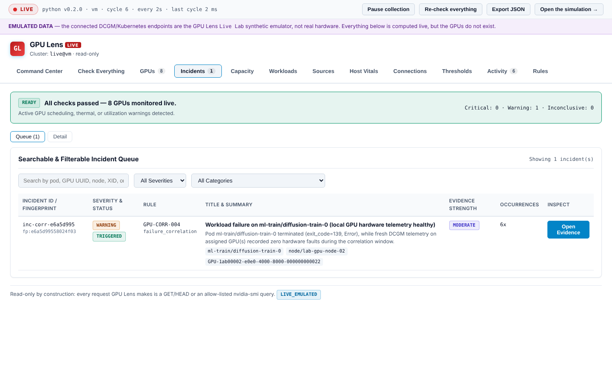

# Go Live — real, read-only telemetry

GPU Lens has two views in one UI:

| | **Go Live** (opens first) | Simulation |
| :-- | :-- | :-- |
| What you see | A live console fed by this machine and your cluster | The original console and its six deterministic scenarios, unchanged |
| Data | `nvidia-smi`, `amd-smi` (experimental), host vitals, DCGM exporter, Prometheus, Kubernetes API, other GPU Lens instances (fleet) | `fixtures/*.json` |
| How to open | The default page (`/`) | **Open the simulation** (top right of Go Live), or `/?view=demo` |
| How to switch back | — | Press the floating **Go Live** button |

The Go Live button lives outside the simulation's root element, so the simulation renders exactly as it did before Go Live existed. Both views share a white theme (default) with a **Dark mode** toggle.

## What happens when you press Go Live

1. The collector starts. Every source is checked **in parallel, every cycle** (default 2 s; DCGM, Prometheus and Kubernetes at most every 5 s / 15 s / 15 s).
2. A **preflight checklist** grades every layer — GPU Lens itself, the host, the local NVIDIA and AMD drivers, DCGM, Prometheus, Kubernetes, and cross-source correlation — as pass / warn / fail / skip / info, each with a plain-language detail and, when something is wrong, a hint that says how to fix it.
3. Per-GPU observations from every source are merged by GPU UUID. Nodes and pods are assembled; with no Kubernetes, GPUs are attributed to the compute process holding most of their memory (namespace `host-processes`) rather than to invented pods.
4. The same six deterministic rules as the demo run on the live data every cycle. Incidents are fingerprint-deduplicated, tracked from first sight, and move to the resolved log when they stop firing.
5. The verdict is one of `ready`, `degraded`, `blocked`, `checking`, `idle`.

**Missing data is never healthy.** A machine with no reachable telemetry yields `blocked` and fleet status `no_telemetry`; a metric that is not exported is reported as *not exported*, never as `0` (each GPU carries the list of metrics its sources really publish, `exported_metrics`).



## Views

Overview (fleet verdict, KPIs, incidents, capacity) · Fleet (every GPU Lens instance, when peers are configured) · Preflight · GPUs (per-GPU cards, sparklines, throttle reasons, PCIe, processes) · Nodes & Pods · Incidents (evidence, resolved log) · Capacity · Trends (history charts with a time cursor) · Host vitals · Sources (latency history, facts, exported-metric audit) · Events · Activity log (filter **Audit** for who changed what) · Rules & Thresholds (live overrides, never touching the demo) · Connections (endpoints, tokens, interval, alerting status and test button, durable-state status) · Export (JSON snapshot / CSV).

## Trying it without a GPU: the Live Lab

```bash
python3 scripts/live_lab.py        # serves a SYNTHETIC dcgm-exporter on :9400 and a read-only Kubernetes API on :8001
make live                          # or: make demo, then press Go Live
```

Those are the addresses GPU Lens probes by default, so no configuration is needed. The lab replays a 12-minute storyline (idle notebook, thermal excursion, Pending 4-GPU job, Xid 79 + pod crash, stalled exporter). It is labelled three ways — a `gpulens_lab_emulator_info` metric, an `X-GPULens-Emulated` header, and a `-gpulens-lab` Kubernetes version suffix — and the console shows an *emulated endpoint* banner and data mode `live_emulated` whenever it is connected. What is real is the pipeline: HTTP collection, parsing, merging, rules, lifecycle.

## Connecting real sources

| Source | Default | Set with |
| :-- | :-- | :-- |
| Local NVIDIA driver | `nvidia-smi` on `PATH` and well-known locations | `--nvidia-smi-path`, `GPULENS_NVIDIA_SMI_PATH`, `--no-nvidia-smi` |
| Local AMD driver (experimental) | `amd-smi` on `PATH`, `/opt/rocm/bin`, `$ROCM_PATH/bin` | `--amd-smi-path`, `GPULENS_AMD_SMI_PATH`, `--no-amd-smi`, `GPULENS_AMD_SMI=false` |
| Host vitals | `/proc`, `/sys` (Linux) | `--no-host-vitals` |
| DCGM exporter | probe `http://127.0.0.1:9400/metrics` | `--dcgm-url`, `GPULENS_DCGM_EXPORTER_URL` |
| Prometheus | probe `http://127.0.0.1:9090` | `--prometheus-url`, `GPULENS_PROMETHEUS_URL`, `…_TOKEN_FILE` |
| Kubernetes | in-cluster service account, else probe `kubectl proxy` on `:8001` | `--kubernetes-url`, `GPULENS_KUBERNETES_URL`, `…_TOKEN_FILE`, `…_CA_FILE` |

Other settings: `--live-interval` / `GPULENS_LIVE_INTERVAL_SECONDS` (1–300), `--live-idle-timeout` / `GPULENS_LIVE_IDLE_TIMEOUT_SECONDS` (default 900 s without a viewer; 0 with `--mode live`), `--cluster-name`, `--mode live` (start collecting at boot, no browser needed), `--no-live` (demo only), `--live-allow-remote-config`.

### Access control, audit, alerting, durable state, fleet (0.3)

| Setting | Flag | Environment variable |
| :-- | :-- | :-- |
| Admin account (basic auth) | `-basic-auth-user`, `-basic-auth-pass-file` (or `-basic-auth-pass`) | `GPULENS_BASIC_AUTH_USER`, `GPULENS_BASIC_AUTH_PASS_FILE`, `GPULENS_BASIC_AUTH_PASS` |
| Read-only viewer account | `-viewer-user`, `-viewer-pass-file` (or `-viewer-pass`) | `GPULENS_VIEWER_USER`, `GPULENS_VIEWER_PASS_FILE`, `GPULENS_VIEWER_PASS` |
| Audit log file (JSON lines) | `-audit-log-file` | `GPULENS_AUDIT_LOG_FILE` |
| Durable live state | `-live-state-file` | `GPULENS_LIVE_STATE_FILE` |
| Slack alerts | `-alert-slack-webhook` | `GPULENS_ALERT_SLACK_WEBHOOK_URL` |
| Webhook alerts | `-alert-webhook-url`, `-alert-webhook-secret-file` | `GPULENS_ALERT_WEBHOOK_URL`, `GPULENS_ALERT_WEBHOOK_SECRET_FILE`, `GPULENS_ALERT_WEBHOOK_SECRET` |
| Alert severity floor | `-alert-min-severity` (`info`, `warning`, `critical`) | `GPULENS_ALERT_MIN_SEVERITY` |
| Console link in alerts | `-public-url` | `GPULENS_PUBLIC_URL` |
| Fleet peers | `-peer name=https://host:8080` (repeatable), `-fleet-interval` | `GPULENS_PEERS` (comma-separated `name=url`) |

The Python runtime takes the same settings with `--double-dash` flags. Guides: [AUTH.md](AUTH.md), [ALERTING.md](ALERTING.md), [FLEET.md](FLEET.md).

For Kubernetes apply `deploy/kubernetes/rbac-readonly.yaml` (get/list/watch on nodes, pods, events — nothing else) and pass that service account's token by file.

A source that is not found at its *default* address is shown as **not found** (neutral). A source you configured explicitly, or that worked earlier in the session and stopped, is shown as **unreachable** (a failure).

## HTTP API

All under `/api/v1/live/`. Same-origin only, no CORS headers.

| Route | Method | Purpose |
| :-- | :-- | :-- |
| `status` | GET | Engine state, tick, interval, runtime (`go` / `python`) |
| `state?since=N&activity_since=M` | GET | Full payload; only history points / activity entries newer than the cursors |
| `start` | POST `{interval_seconds?}` | Start collecting (idempotent) |
| `stop` | POST | Stop collecting |
| `recheck` | POST | Re-probe every source now |
| `config` | POST | Patch cluster name, interval, source enable/endpoint/token. Restarts the session unless only the interval changed |
| `thresholds` | POST `{overrides, reset}` | Live rule-threshold overrides (validated; demo unaffected) |
| `alerts` | GET | Alert destinations (path redacted) and their delivery record |
| `alerts/test` | POST | Send a test alert to every destination now |
| `summary` | GET | Compact health of this instance; what fleet hubs poll |

Outside `/api/v1/live/`: `GET /api/v1/audit?since=N` (audit log), `GET /api/v1/fleet` (fleet view), `GET /metrics` (GPU Lens's own health, Prometheus text format). The complete, machine-readable reference is [openapi.yaml](openapi.yaml).

**Roles.** With basic auth enabled, everything except `/healthz` and `/readyz` needs credentials. The **viewer** role can read every endpoint and `start` collection (to resume watching); `stop`, `recheck`, `config`, `thresholds`, `alerts/test` and changing the interval need **admin**. Refusals are audited.

Guards on every route: a loopback caller must send a local `Host` header (DNS-rebinding defence); cross-origin requests are refused; POST requires `Content-Type: application/json`. Connection settings (endpoints, tokens, cluster name) can only be changed from the machine running GPU Lens, or with `--live-allow-remote-config`; a request that came through a reverse proxy (`X-Forwarded-For`, `Forwarded`, `X-Real-IP`) is never treated as local. Bearer tokens are write-only: the API reports `token_set: true`, never the token. File paths (nvidia-smi binary, token/CA files) are not settable over the API.

## Testing

```bash
go test -race ./...                 # engine, merge, lifecycle, preflight, API guards (test doubles, no network)
python3 tests/live_blackbox.py both # the real Go binary and the Python runtime: bare machine → blocked, request guards,
                                    # nvidia-smi test double, Live Lab (rules, thresholds, config, token secrecy, dead endpoint)
```

`tests/fixtures/fake-nvidia-smi` and `tests/fixtures/fake-amd-smi` are test doubles that print canned answers to the handful of read-only queries GPU Lens issues; they are not GPU tools. The black-box suite also covers basic auth and roles, the audit log, webhook alerts with signature verification, `/metrics`, AMD GPUs, durable state across a restart and a three-instance fleet — on both runtimes.

## Honest limits

- Real-hardware coverage is still small: the `nvidia-smi` path has run on a GeForce RTX 3050 Laptop GPU; the DCGM, Kubernetes and Prometheus adapters were built against the Live Lab and Go `httptest` servers; the AMD adapter against a test double built from AMD's documented `amd-smi` JSON. Older drivers, MIG and unusual output deserve real-machine runs — please report what you see.
- AMD GPUs are evaluated by the utilization, memory, thermal, power and ECC rules. NVIDIA-specific signals (Xid, NVLink, row remapping) have no AMD equivalent in GPU Lens yet; Check Everything says so.
- The Python runtime (used when Go is not installed) reads Prometheus with one instant query: no history backfill, no scrape-target audit, no clock-skew check. Those three preflight checks say so rather than pretending.
- MIG slices and shared-GPU resources appear as separate devices but are not part of the capacity math.
